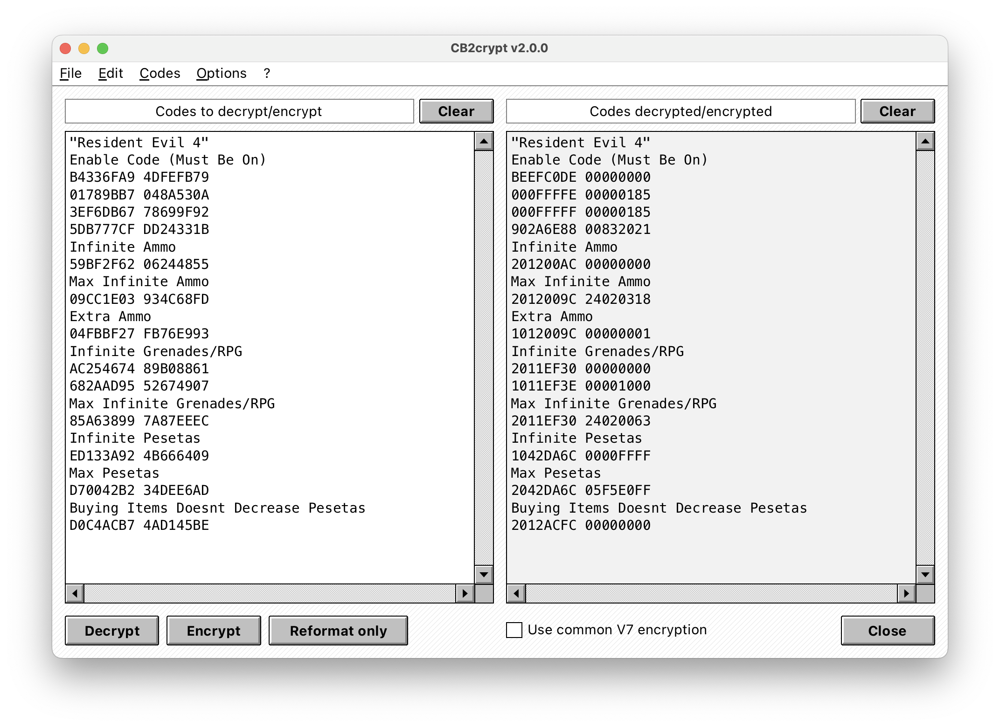

# CB2crypt

The 2006 Windows tool for CodeBreaker PS2 cheat codes, rebuilt in Rust.
It was the first to decrypt the codes of CodeBreaker V7.



Made possible by [saudade](https://github.com/roblillack/saudade), whose pixel-perfect Windows 3.1 controls were just the right fit for reviving it.

Paste or load a code list on the left, choose Decrypt or Encrypt, and the result appears on the right.
Game titles and code names pass through untouched.

## Build and run

With a recent [Rust toolchain](https://rustup.rs):

```console
cargo run --release
```

Add `-- --dark` for a dark theme.

CB2crypt is developed and tested on macOS.
The toolkit it is built on also runs on Windows and Linux, but the app is untried there.

## History

CB2crypt began as a Windows program written in C.
I released it in March 2006, two weeks after cracking the CodeBreaker V7 code encryption, and updated it until v1.4 in January 2007.

Twenty years later I rebuilt it in Rust as version 2, working with Claude Code and Fable 5.2, which also tested the app through computer use, clicking through the real window and taking the screenshot above.
It looks and works as the original did: the same menus, text boxes and buttons.
The crypto now comes from the [codebreaker](https://github.com/mlafeldt/codebreaker-rs) crate, which grew out of the original's C code.

The original Windows program lives on in the [`windows`](https://github.com/mlafeldt/CB2crypt/tree/windows) branch, and every release from v1.0 to v1.4 keeps its tag.
Its [readme](https://github.com/mlafeldt/CB2crypt/blob/windows/readme.txt) is still the place to learn how the codes work: what a Beefcode is, how V7 differs from V1, and how to add your own codes to an official list.

## License

Copyright (c) Mathias Lafeldt

Licensed under the [Apache License, Version 2.0](LICENSE-APACHE) or the [MIT license](LICENSE-MIT), at your option.

The Windows program, up to v1.4, is licensed under the GNU General Public License, version 2 or later.
